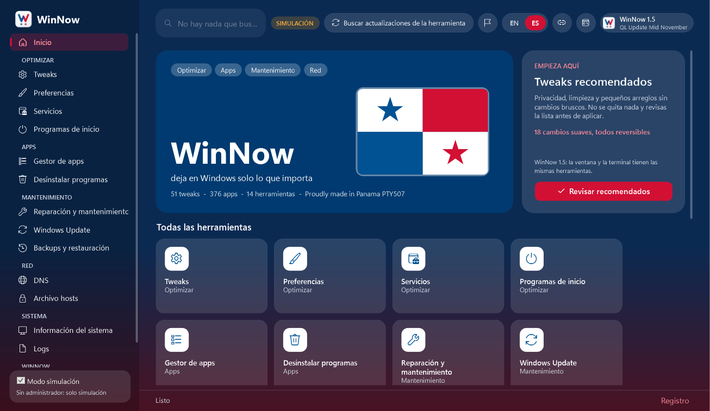
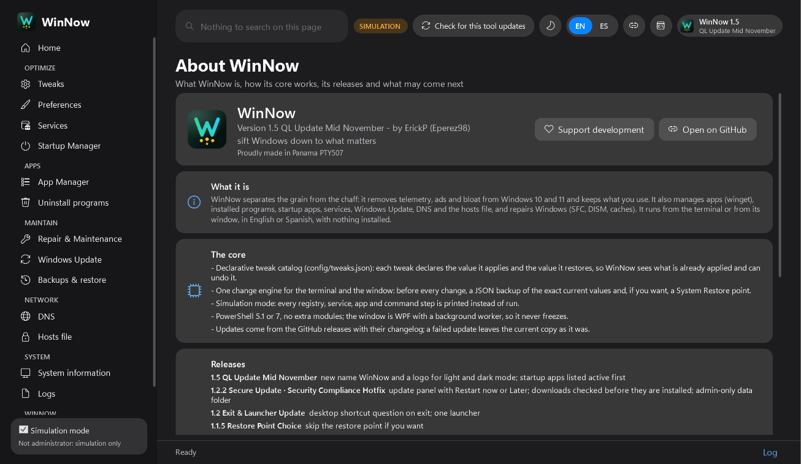
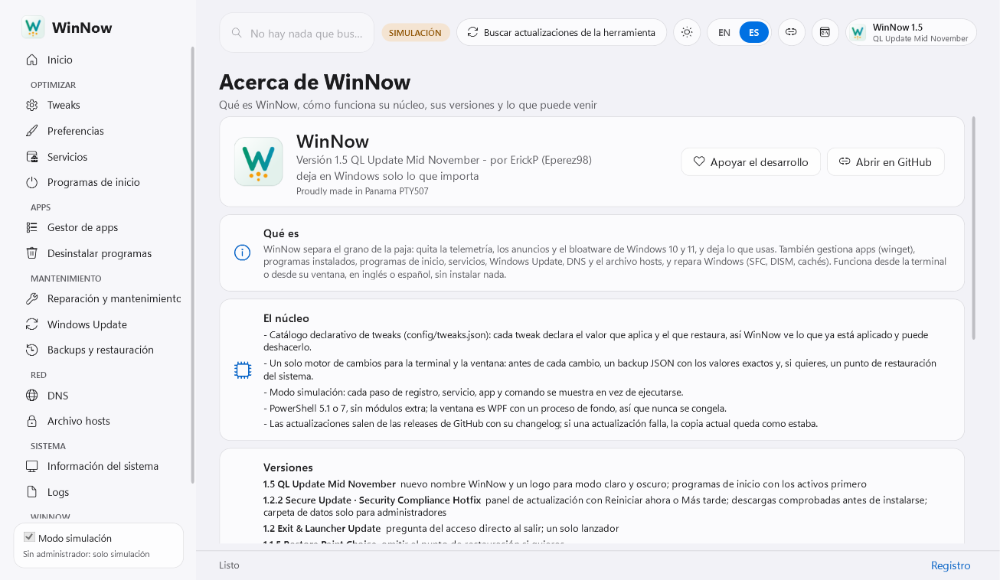
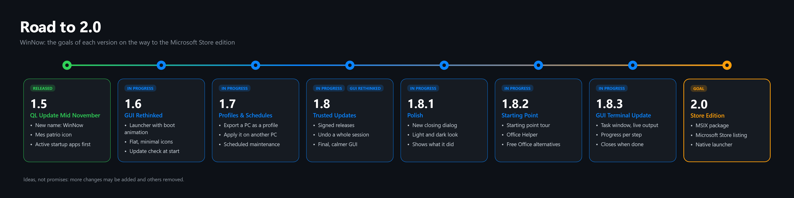

<p align="center">
  
</p>

<p align="center"><b>Winnow becomes WinNow.</b><br/>A new name and logo, the whole winget catalog in the App Manager, and the road to 2.0.</p>

<p align="center">
  
</p>

---

### Run it

```powershell
irm eperez98.github.io/WinNow | iex
```

Pick the language, then **Terminal** or **Graphical interface**. Nothing is installed, and simulation mode lets you look around without changing anything.

Offline: download **Winnow.zip** below, extract it, and run `Launch.bat` as administrator. It asks for the mode.

### What's new

**The name is now WinNow.** The terminal, the window, the docs and the desktop shortcut say WinNow. File names, folders and links keep their old spelling, so existing copies, backups and updates keep working.

**A logo for light and dark mode.** The mark and the banner are redrawn in a dark and a light version. The README shows the one that matches GitHub's theme, and the window switches its logo with the theme.

**Mes patrio icon.** November is Panama's patriotic month, so the 1.5 app icon (window, taskbar, desktop shortcut) wears the flag of Panama: a white tile, the W in Panama blue and red, and the flag's two stars.

**The whole winget catalog.** On the App Manager, typing a name searches every winget package after a short pause, keeps the catalog apps that match and adds every winget result, even the ones that match by tag. Apps outside the catalog, such as Steam, now show up. In the terminal, **Search all of winget** is the first option of the App Manager.

**Startup apps, active first.** The Startup Manager lists the active entries first, then the disabled ones, alphabetical inside each group, in the terminal and the window.

**About WinNow** lists every release and the road to 2.0.

| About, dark | About, light (Spanish) |
|---|---|
|  |  |

### Since 1.2.2

If you are coming from an older copy, these arrived on the way here:

- **1.2.2 Secure Update · Security Compliance Hotfix**: admin-only data folder, backups trusted only from administrators, SYSTEM or you, updates checked file by file before they are installed, all-or-nothing install, and the update panel with Restart now / Later. It also carried 1.2 Exit & Launcher Update: the desktop shortcut question on exit and one launcher.
- **1.1.5 Restore Point Choice**: the System Restore point is optional; the JSON backup is always taken.
- **1.1 Full GUI Release**: the window leaves preview, with a step-by-step progress bar, **List available upgrades**, and Light / Dark / Mes patrio themes.

### Road to 2.0



The goals of each version on the way to **2.0 Store Edition**, a WinNow you can install from the Microsoft Store:

| Version | Name | Goals |
|---|---|---|
| **1.5** | QL Update Mid November | New name WinNow, logo for light and dark mode, the mes patrio icon, the whole winget catalog, active startup apps first (this release) |
| **1.6** | GUI Rethinked | Launcher window with a boot animation, flat and minimal icons, update check at start |
| **1.7** | Profiles & Schedules | Save a PC as a profile, export it and apply it on another PC; scheduled maintenance |
| **1.8** | Trusted Updates | Signed releases, a history of every session with undo, and the final GUI Rethinked: smaller icons, a reorganized menu, smoother animations |
| **1.8.1** | Polish | A closing dialog in the window's own look |
| **1.8.2** | Starting Point | Starting point tour; Office Helper: remove Outlook and Office, install Thunderbird, LibreOffice or OpenOffice |
| **1.8.3** | GUI Terminal Update | A task window with the live output and a progress bar for updates, upgrades and removals |
| **2.0** | Store Edition | MSIX package, Microsoft Store listing, native launcher |

Ideas, not promises: more changes may be added and others removed.

### Support development

If WinNow helps you, you can support its development with a donation through [PayPal](https://www.paypal.com/donate/?business=erapc%40outlook.com&currency_code=USD). It is also in the app: About > Support development.

### Updating

Copies from 1.0.7.1 to 1.2.2 offer this version in their update check, in the terminal and in the window.

Full history in the [CHANGELOG](https://github.com/eperez98/WinNow/blob/v1.5/CHANGELOG.md).

<p align="center"><sub>Proudly made in Panama PTY507</sub></p>
