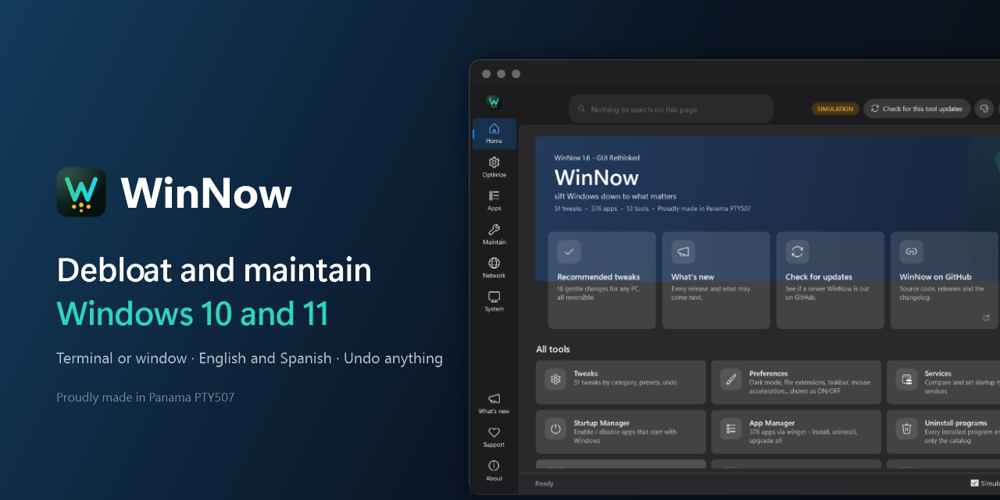
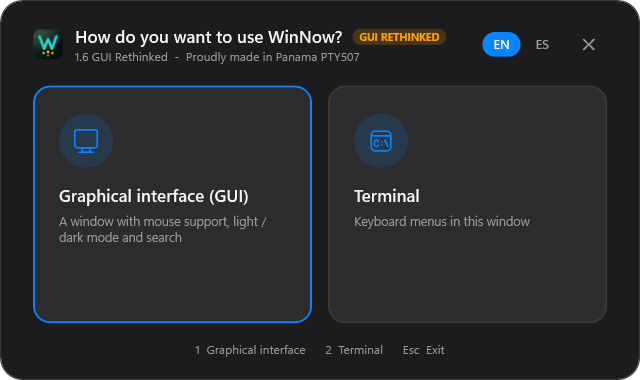
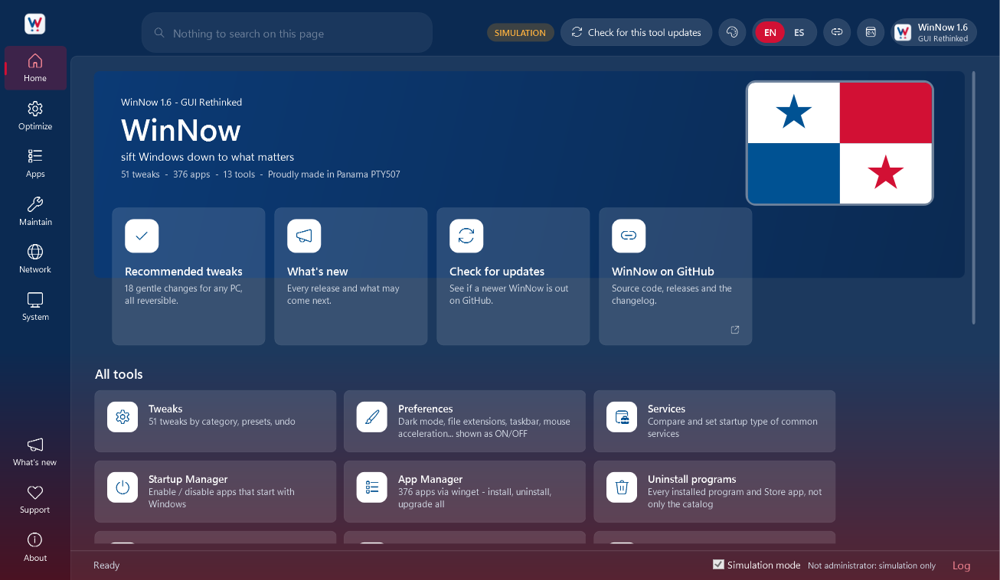
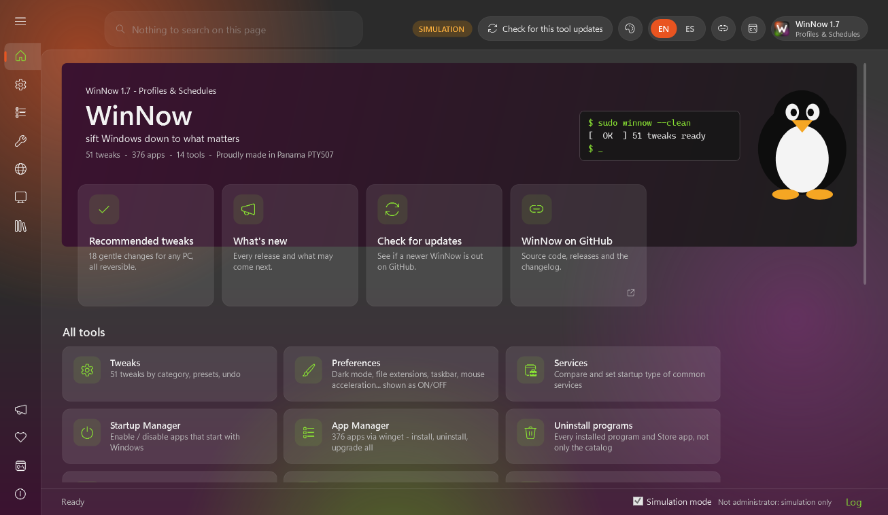
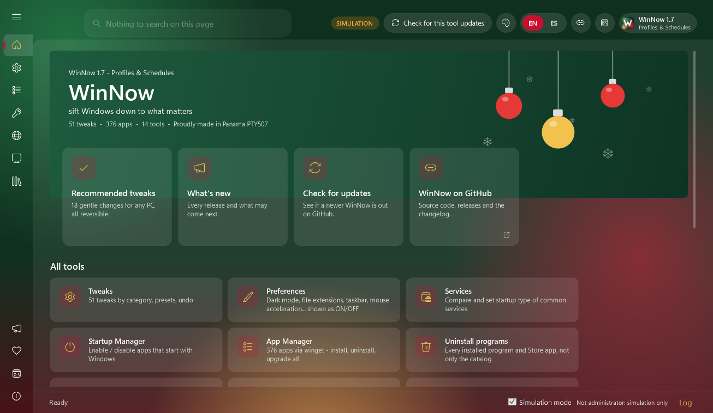
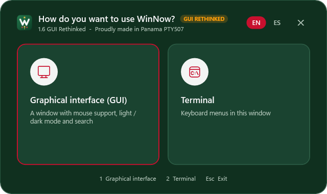
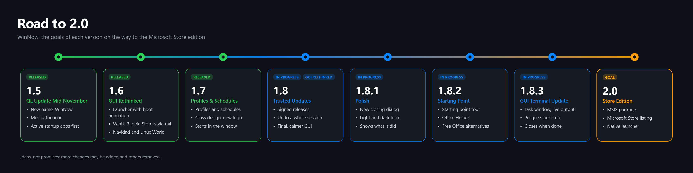

<p align="center">
  
</p>

<p align="center"><b>GUI Rethinked.</b><br/>A launcher with a boot animation, a window in the WinUI 3 style, and five themes.</p>

---

### Run it

```powershell
irm eperez98.github.io/WinNow | iex
```

The launcher opens: pick **EN** or **ES**, then **Graphical interface** or **Terminal**. Nothing is installed, and simulation mode lets you look around without changing anything.

Offline: download **Winnow.zip** below, extract it, and run `Launch.bat` as administrator.

### What's new

**A launcher on every start.** `Launch.bat`, the one-line command and the desktop shortcut open a small window: the logo grows in and three dots pulse, then **Graphical interface** and **Terminal** appear as two cards, with the **EN | ES** switch on top. Click a card, press `1` / `2` or the arrow keys and Enter, or `Esc` to exit; any key skips the animation. It replaces the console language and mode screens, which stay as the fallback where a window cannot open.

<p align="center">
  
</p>

**Updates while it starts.** During the boot animation the launcher asks GitHub for a newer release. When there is one, a bar offers **Update now** (download, replace this copy, open again) or **Later**. The window and the terminal then skip their own check.

**WinUI 3 look.** A navigation rail like the Microsoft Store, with an icon over each label: Home, one item per group of tools, and What's new, Support and About at the bottom. Each group opens its tools as cards. Home has a hero with the version and the name, start cards over its edge (recommended tweaks, what's new, updates, GitHub) and every tool as a card. Pages sit on a layer with a rounded corner, and the log is a card with the lines on a code surface.

**Five themes.** The theme button unfolds a panel inside the window, and the themes slide in one after the other:
- **Light** and **Dark**.
- **Mes patrio**: the Panama icon on the window, the taskbar, the desktop shortcut and the launcher, the flag of Panama on the Home hero, white tiles with Panama-blue icons, navy and red. It is the starting theme in November.
- **Navidad**: a Christmas icon on the window, the taskbar, the desktop shortcut and the launcher, ornaments and snowflakes on the Home hero, pine green and Christmas red. It is the starting theme in December, and the launcher's boot gets falling snow and a logo that swings like an ornament.
- **Linux World**: a terminal-dark backdrop that turns aubergine at the bottom, an orange accent, terminal-green text, an icon with a penguin, and a terminal and a penguin on the Home hero.

| Mes patrio | Linux World |
|---|---|
|  |  |

| Navidad | Launcher in Navidad |
|---|---|
|  |  |

**Quiet icons.** Tool icons are line glyphs on a quiet tile that follows the theme: white or black, Panama blue on white in Mes patrio, gold in Navidad, terminal green in Linux World.

**Small things.** The name in the top bar is smaller and opens About. A click in the search box selects its text. **Support** in the rail opens the PayPal donation page. The labels read **GUI RETHINKED**.

**A new README.** The repository page has a new layout with a hero image, screenshots in English and Spanish, and a Spanish README.

### Also from 1.5

The App Manager searches the whole winget catalog as you type, the search never waits behind other tasks, and the Startup Manager lists active apps first.

### Updating

Copies from 1.0.7.1 to 1.5 offer this version in their update check. From 1.6 on, the launcher checks while it starts.

### Road to 2.0



Next: **1.7 Profiles & Schedules** — save a PC as a profile and apply it on another, and scheduled maintenance. More changes may be added and others removed.

### Support development

If WinNow helps you, you can support it with a donation through [PayPal](https://www.paypal.com/donate/?business=erapc%40outlook.com&currency_code=USD), also in the app: Support in the rail.

Full history in the [CHANGELOG](https://github.com/eperez98/WinNow/blob/v1.6/CHANGELOG.md).

<p align="center"><sub>Proudly made in Panama PTY507</sub></p>
