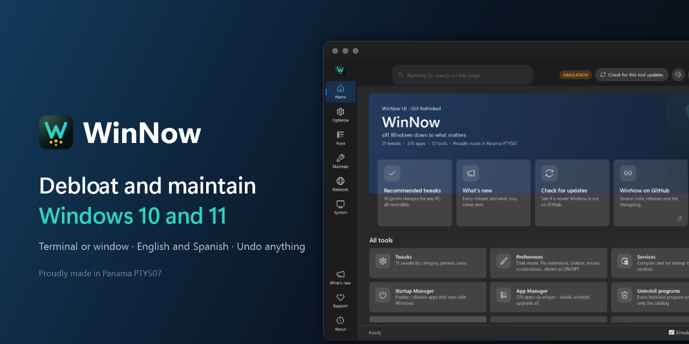
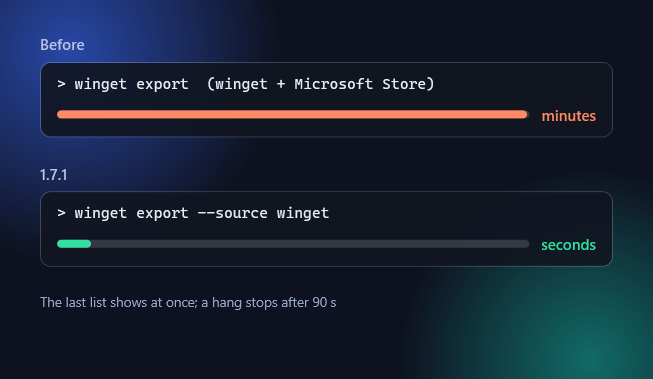

<p align="center">
  
</p>

<p align="center"><b>Winget HotFix.</b><br/>The installed apps are read in seconds again, and the compact menu shows its selection whole.</p>

---

### Run it

```powershell
irm eperez98.github.io/WinNow | iex
```

Offline: download **Winnow.zip** below, extract it, and run `Launch.bat` as administrator.

### Fixed

**Reading the installed apps took minutes.** To know which apps are installed, WinNow runs `winget export`. Without a source, winget also looked every package up in the Microsoft Store online, which took minutes on some PCs. The App Manager, installs, uninstalls and the backup before a change all waited for it. Now WinNow reads only the winget source, where every app of its catalog lives, so the result is the same in a few seconds.

- A winget that hangs is stopped after 90 seconds, and the log says so.
- The list is saved in `installed-apps.json`: the App Manager shows the installed tags at once while it reads the fresh list, and a failed read keeps the last list instead of showing nothing installed.

**The compact menu cut the selected item.** With the menu folded, each item kept the width of the open menu, so its highlight was cut at the edge and ran under the page. Each item is now its icon column, with rounded ends; open, the items fill the menu again.

<p align="center">
  
</p>

### Updating

Copies from 1.0.7.1 to 1.7 offer this version in their update check. Coming from 1.7, the What's new card shows only this fix.

Everything else is as in [1.7 Profiles & Schedules](https://github.com/eperez98/WinNow/releases/tag/v1.7). Full history in the [CHANGELOG](https://github.com/eperez98/WinNow/blob/v1.7.1/CHANGELOG.md).

<p align="center"><sub>Proudly made in Panama PTY507</sub></p>
