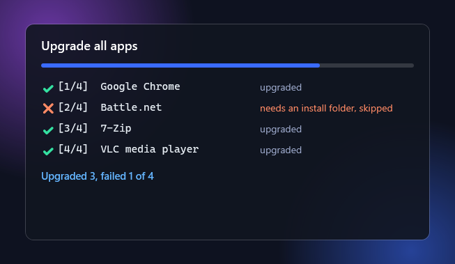

<p align="center">
  
</p>

<p align="center"><b>Upgrade HotFix.</b><br/>Upgrade all apps now goes app by app, and one app can no longer stop the rest.</p>

---

### Run it

```powershell
irm eperez98.github.io/WinNow | iex
```

Offline: download **Winnow.zip** below, extract it, and run `Launch.bat` as administrator.

### Fixed

**Upgrade all apps did nothing.** WinNow ran `winget upgrade --all` without questions. When a single app could not upgrade unattended (Battle.net, for example, asks for an install folder), winget stopped the whole batch, and none of the other apps was upgraded. WinNow now upgrades one app at a time:

- each app shows its step, `[2 of 5] Google Chrome`, and the progress bar follows it;
- an app that fails is reported and the others go on;
- a summary at the end says how many were upgraded and how many failed.

This works the same in the terminal, the window and the scheduled maintenance. Apps whose installed version winget cannot tell are left out, as `winget upgrade` itself lists them.

**"Reading installed apps" looked stuck.** The read finished in a second, but nothing said so. The status bar and the log now show how many installed apps were read.

### Updating

Copies from 1.0.7.1 to 1.7.1 offer this version in their update check. Coming from 1.7 or 1.7.1, the What's new card shows only these fixes.

Everything else is as in [1.7 Profiles & Schedules](https://github.com/eperez98/WinNow/releases/tag/v1.7) and [1.7.1 Winget HotFix](https://github.com/eperez98/WinNow/releases/tag/v1.7.1). Full history in the [CHANGELOG](https://github.com/eperez98/WinNow/blob/v1.7.2/CHANGELOG.md).

<p align="center"><sub>Proudly made in Panama PTY507</sub></p>
