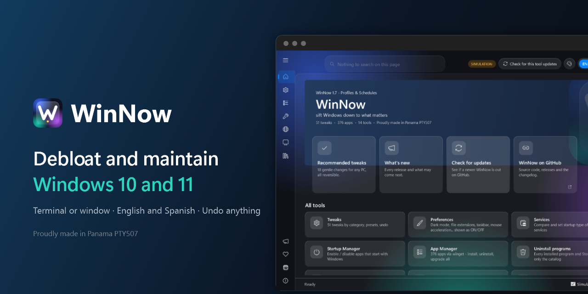
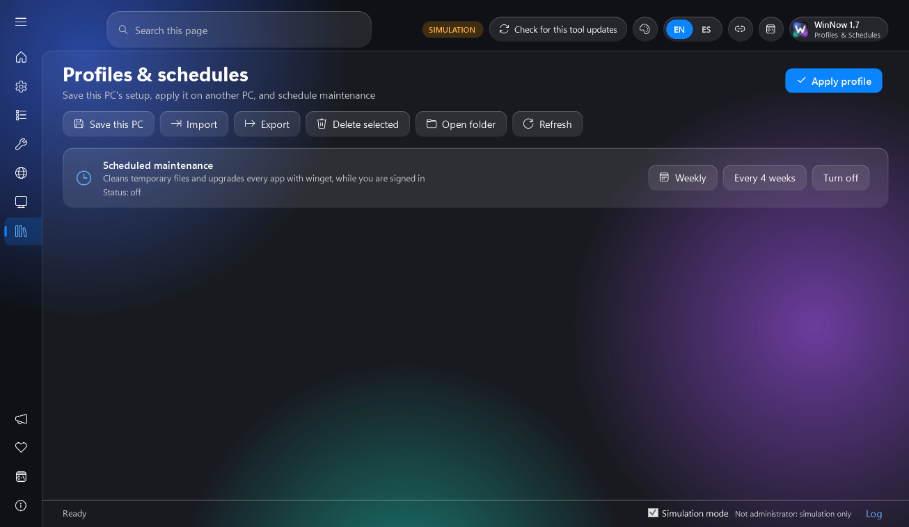
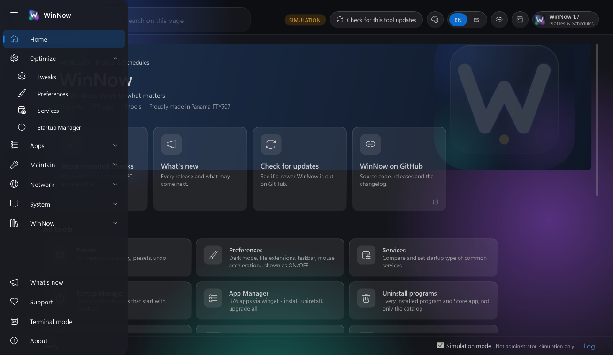
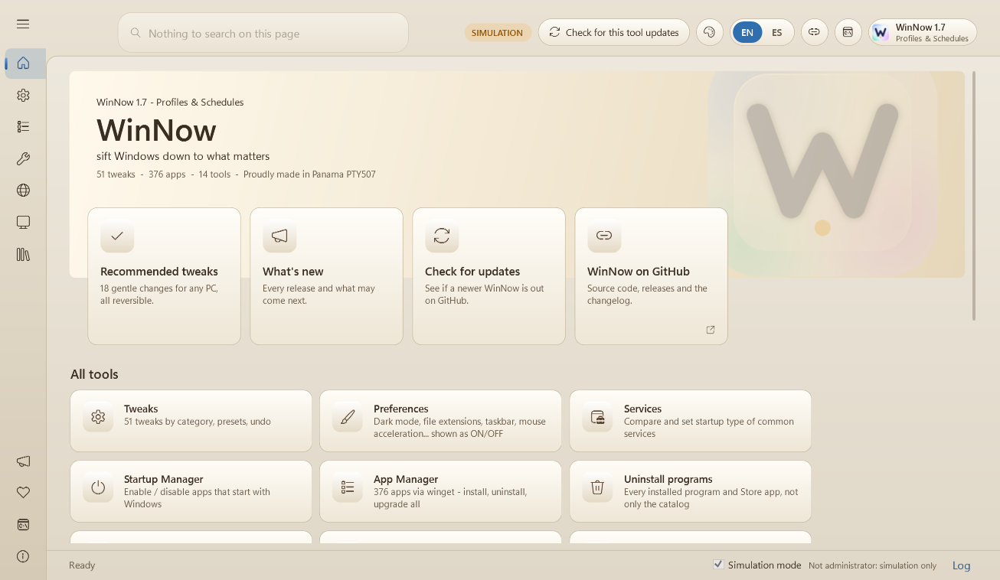
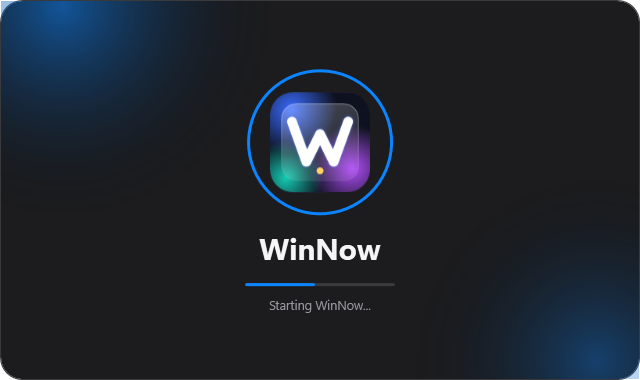
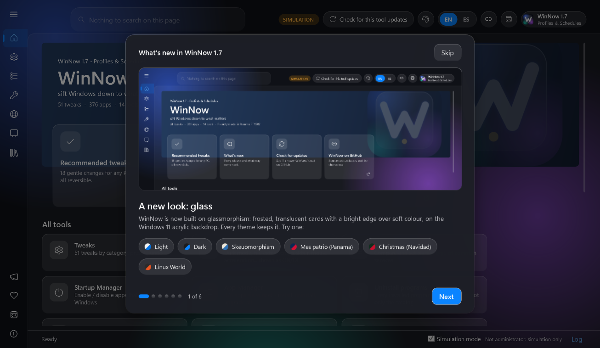
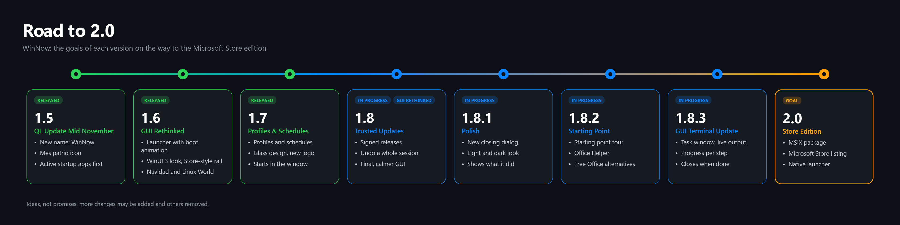

<p align="center">
  
</p>

<p align="center"><b>Profiles & Schedules, and GUI Rethinked takes its final shape.</b><br/>Glass design, a new logo, a menu that expands, and WinNow opens straight in the window.</p>

---

### Run it

```powershell
irm eperez98.github.io/WinNow | iex
```

The first time, pick the language, the window or the terminal, and Light or Dark. After that WinNow opens straight in your choice. Nothing is installed, and simulation mode lets you look around without changing anything.

Offline: download **Winnow.zip** below, extract it, and run `Launch.bat` as administrator.

### Profiles & Schedules

**Profiles.** Save this PC as a profile: the tweaks and preferences that are applied and the catalog apps that are installed. Export it to a `.json` file, import it on another PC and apply it in one step, with the usual backup and restore point. An imported profile keeps only items from WinNow's catalog.

**Scheduled maintenance.** A Windows scheduled task, every week or every four weeks, cleans temporary files and upgrades every app with winget, with a backup of the app list first. Turn it on or off from the same page. `-Maintain Temp,Upgrade` runs the same maintenance from a script.

<p align="center">
  
</p>

### A new design

**Glassmorphism.** Frosted, translucent cards with a bright edge over soft colour, on the Windows 11 acrylic backdrop. Every theme is built on it.

**A new logo.** A white W on a frosted glass pane, with a gold grain for "Now" (a star in Navidad and Mes patrio). It is on the window, the taskbar, the desktop shortcut and the launcher.

**A menu that grows with you.** The menu stays compact as icons. The menu button expands it over the page with labels, and the arrow next to a group lists its tools, so you reach them in one click. It folds away when you pick something, and a tool's page also marks its group.

**Skeuomorphism.** A new theme with paper, depth and glossy buttons, next to Light, Dark, Mes patrio, Navidad and Linux World.

| Menu | Skeuomorphism |
|---|---|
|  |  |

### Straight to the window

**A new start.** A ring draws itself around the logo, the logo comes into focus, the name rises and a thin line fills, with a short, soft chime. Then WinNow opens the window directly. **Terminal mode** in the menu switches to the console, and `-Terminal` still starts there.

**Welcome.** The first start asks for the language, the window or the terminal, and Light or Dark, once.

**What's new.** After an update, a card with slides that move sideways shows what changed, with a picture for each. The design slide lets you try a theme right there, and the last one sets how WinNow starts and whether the chime plays. **What's new** in the menu shows it again.

| Start | What's new |
|---|---|
|  |  |

### Updating

Copies from 1.0.7.1 to 1.6 offer this version in their update check. Your settings carry over; the What's new slides show once.

### Road to 2.0



Next: **1.8 Trusted Updates** — signed releases and undo for a whole session. More changes may be added and others removed.

### Support development

If WinNow helps you, you can support it with a donation through [PayPal](https://www.paypal.com/donate/?business=erapc%40outlook.com&currency_code=USD), also in the app: Support in the menu.

Full history in the [CHANGELOG](https://github.com/eperez98/WinNow/blob/v1.7/CHANGELOG.md).

<p align="center"><sub>Proudly made in Panama PTY507</sub></p>
